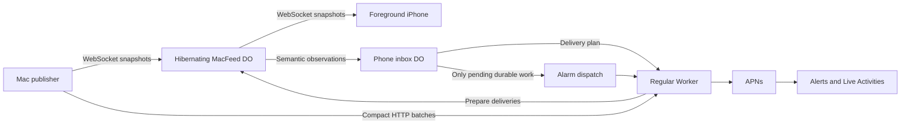

# Relay cost trial — October 6, 2026

Protocol 2 was deployed to `codexgauge-relay-dev` at **2026-10-06 12:57:31 UTC (08:57:31 EDT)**. Initial version: `3bfe9841-2f06-45fc-a957-38241e915372`. The final revision, which also durably retries important Live Activity state changes, was deployed at **13:11:42 UTC (09:11:42 EDT)** as `34472604-59f5-4d95-bee8-8a58cca18ae5`. `/health` reports `protocol: 2`, `architecture: publisher-driven-push`.

The original MacFeed and PushReceiver namespaces and their pairings were deleted as authorized. Cloudflare initially rejected deletion while the old bindings were attached; removing those bindings through the settings API allowed the deployment. The APNs secret was retained and its binding verified afterward. This was a destructive development reset, with no application-data migration.

Current namespace IDs are retained in the local analytics evidence. The read-only reporting tool discovers `MacFeedV2` and `PushReceiverV2` without embedding account-specific namespace IDs in the repository.

## Architecture and expected savings



- Foreground WebSocket frames do not fan out to push receivers. The full feed checkpoints at most once every five minutes. Opening a viewer requests a fresh frame. A widget read of an old checkpoint waits up to 1.5 seconds for a connected Mac; disconnected reads return the dated checkpoint immediately.
- The Mac sends compact HTTP batches every five seconds during active tasks, promptly for important transitions, and every thirty seconds while idle. A local atomic journal holds at most 128 transition observations, expires old history, sends batches in order, and removes only acknowledged observations. Overload beyond that bound can discard intermediate transitions.
- Routine metrics live in receiver memory. APNs acceptance of a routine metric needs neither a database write nor a receipt RPC. Metrics may repeat after eviction, and newer observations replace lost metrics.
- Notification baselines, pairing/preferences, ActivityKit lifecycle state, important task-state updates and alerts are durable. Alerts retain one-hour expiry, bounded retries and cross-Mac account deduplication. Starts and important Live Activity updates expire after three minutes. New semantic states supersede pending obsolete updates, including an approval update overtaken by completion. End and revocation jobs can retry after the Mac disconnects. Leases prevent an obsolete receipt from deleting a newer retry.
- APNs network requests run in a regular Worker. The receiver returns a delivery plan before the network wait. Alarms hand pending work to a named Worker entrypoint and leave a durable lease for crash recovery. Explicitly cleared APNs timeouts replace an internal timer that remained alive after successful requests.
- Existing Live Activity delivery policy remains: metrics at five seconds with frequent updates, fifteen seconds otherwise; phase changes coalesced to thirty/sixty seconds; prompt freshness at two minutes; stale indication at three minutes. Apple still controls actual presentation. No server polling alarm is maintained just for routine freshness.

This keeps one coordinator per Mac and one inbox per phone, preserving the existing authorization and multi-Mac account behavior. It does not introduce a new user-account service. The main expected reductions are billed DO duration and storage writes; the separate push path adds ordinary Worker requests. The $0.30/user/month target is **not yet measured or guaranteed**.

**Trial setup is temporarily blocked by the account’s existing daily SQLite write cap.** At approximately 13:17 UTC, live logs reported `Exceeded allowed rows written in Durable Objects free tier.` October 6 analytics already attributed 102,427 writes to the old PushReceiver namespace and 1,622 to the old MacFeed namespace (104,049 combined). Namespace replacement does not reset account-wide usage. The allowance resets at 00:00 UTC on October 7, which is **8 p.m. Eastern on October 6**. Re-pair after that reset; no paid-plan upgrade was performed.

## Baseline

Local `Review/Relay-Cost-Baseline-2026-10-05.json` analytics cover October 5, 00:00–24:00 UTC. This account-specific evidence is excluded from Git. It includes the old relay's development/test activity as well as normal use and is not a controlled per-user benchmark.

| Metric | Old relay, October 5 |
| --- | ---: |
| DO billed duration reported by analytics | 14,381.36 GB-s |
| DO active time | 31.21 object-hours |
| DO CPU time | 127.54 seconds |
| SQLite rows written | 38,153 |
| SQLite rows read | 1,092,957 |
| Regular Worker requests | 703 |

These complete-day values supersede the earlier partial-day investigation totals. Two subscribed iPhones and one Mac were reported by the user; one phone was on an older build. The reset day also contains deployment and synthetic verification traffic, so start the comparison after re-pairing and use complete later days.

## Verification

- `Scripts/check-companion.sh`: 46 Swift core tests and 56 relay tests passed, including local Cloudflare runtime tests and the Worker bundle check.
- Runtime tests cover 200 metric observations plus an actual accepted low-priority push without any receiver writes; no metric polling alarms; durable alert recovery across process restart; old receipt rejection; shared-account deduplication; alarm-to-Worker delivery; lifecycle end retries and revocation.
- Mac unit suite: 119 tests passed, one skipped (125 successful parameterized executions). Mac and iPhone simulator app/test builds succeeded.
- Live deployment: health, replacement namespace inventory and APNs secret binding verified. A disposable 30-frame WebSocket probe measured **20.7 ms median, 22.8 ms p95, 44.7 ms maximum**. This is transport between a Mac-hosted publisher and viewer through Cloudflare; it excludes Codex polling, iPhone rendering, mobile radio latency and APNs.
- Real APNs/ActivityKit on the iOS 27 simulator: background start → needs approval → tap to the correct task → completion/card removal passed in 113.6 seconds. Evidence: `.build/relay-v2-live-check-current-ui.xcresult`. The test was updated for current Settings controls after its old test-notification-button step failed. A repeat against the final revision was blocked during feed creation/pairing by the account-wide write quota, confirmed in live Cloudflare logs; it did not reach APNs. The final revision passed all local runtime tests. Physical iPhone delivery on protocol 2 still needs a linked-device check.

## Start and measure the trial

The updated development Mac app replaces the previously running build at `.build/updater-tests/Build/Products/Debug/CodexGauge.app`; the previous app bundle is retained at `.build/relay-v2-previous/CodexGauge.app`. A separate build is at `.build/relay-v2-mac/Build/Products/Debug/CodexGauge.app`. The signed public app in `/Applications` was not replaced.

Open Mac **Settings → Devices → Pair iPhone…** and re-link the intended phone(s) from iPhone **Settings → Link a Mac**. Remove obsolete phone links as needed. Ensure sharing is enabled, verify foreground tasks, enable an alert type, and check a real transition plus a background Live Activity. The current Settings screen has no test-notification button. Existing phone builds can use the same viewing/push endpoints, but use the current build when evaluating current ActivityKit behavior. Record whether one or both phones participate and approximately how many hours tasks run each day.

After at least two or three complete days, run from `Companion/Relay`, adjusting the dates and user count to the actual trial:

```sh
vp exec node tests/usage-report.mts \
  --account "$CLOUDFLARE_ACCOUNT_ID" \
  --from 2026-10-07T00:00:00Z --to 2026-10-10T00:00:00Z \
  --users 1 --out ../../Review/Relay-Cost-After.json
```

The command is read-only, discovers the current namespaces, and uses Wrangler's existing authentication without printing credentials. It reports DO billed duration, CPU, rows read/written, incoming WebSocket counts, invocation types/errors, Worker requests and Worker CPU. Analytics can be delayed or sampled. The publisher-authenticated `/diagnostics` endpoint provides volatile runtime counters, not billing totals; its write counter counts SQL operations and omits alarm/index amplification. Cloudflare analytics remain the basis for cost comparison.

Normalize by representative active-user days and project to thirty days. Separate marginal usage costs from the shared paid-plan minimum and included allowances; account for the actual phone count. Inspect retries, errors, alert delivery and stale cards alongside cost so that a lower bill does not conceal missing work. Pricing references: [Durable Objects](https://developers.cloudflare.com/durable-objects/platform/pricing/) and [Workers](https://developers.cloudflare.com/workers/platform/pricing/).

No paid-plan upgrade, public release, TestFlight upload or recurring monitoring job was created by this change.
